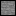
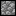
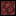
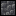
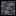
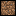
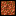

# Squeeze

I have too much stuff! There should be a mod where I can compress my blocks further!
Ok I did that! Not very original I know, but there aren't many versions for current versions of Minecraft.

## Supported Versions

Minecraft 26.1.x - 26.2

## Download

- [Download the mod from Modrinth](https://modrinth.com/mod/squeeze)
- You will also need [Fabric API](https://modrinth.com/mod/fabric-api), any version

## Features

Common blocks are now compressible. You can craft the next tier of compression
by putting 9 of a common item in a crafting table.

### Tiers

1. Compressed

2. Squeezed

3. Hardened
   

### Supported Blocks

- Stone

- Cobblestone

- Netherrack

- Sugarcane

- Bamboo

- Iron

- Redstone

- Gold

- Cobbled Deepslate

- Deepslate

- Dirt

- Grass

- Rotten Flesh

- Cactus

## Collaboration

This is intended to be a solo project, although suggestions for new blocks/features and tips are always welcome!

## License

This project is distributed under an MIT license. View [LICENSE](LICENSE) for more info.